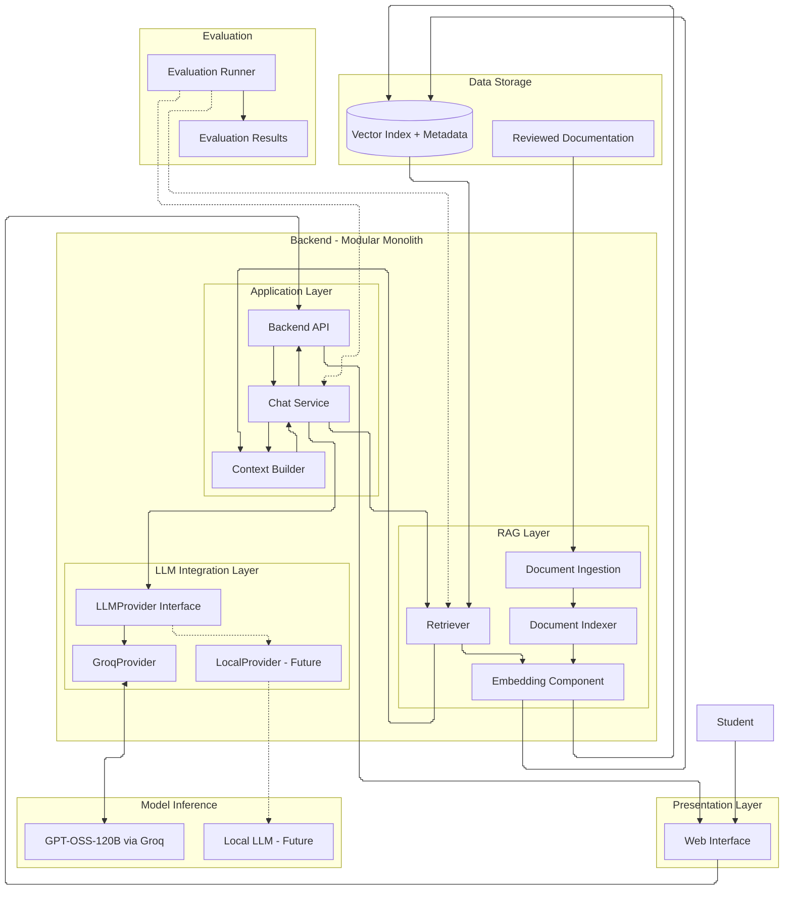
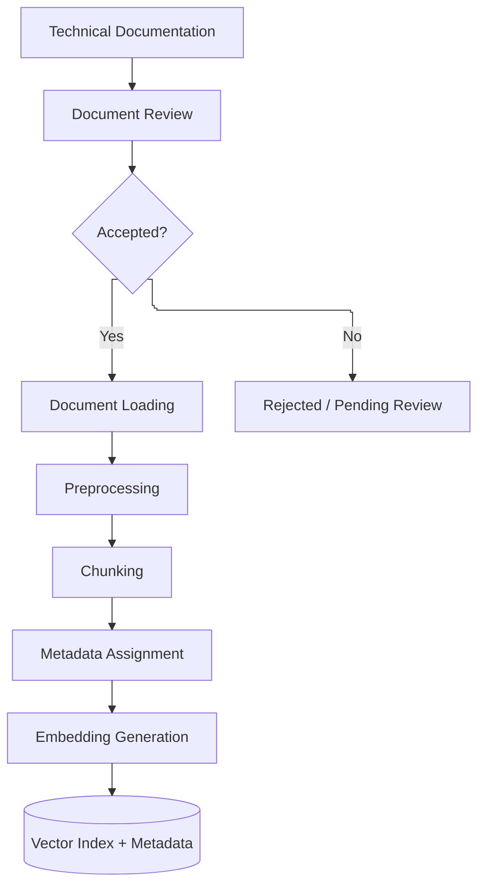
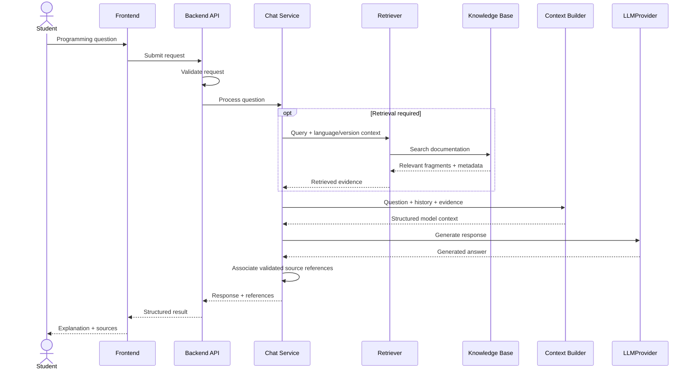
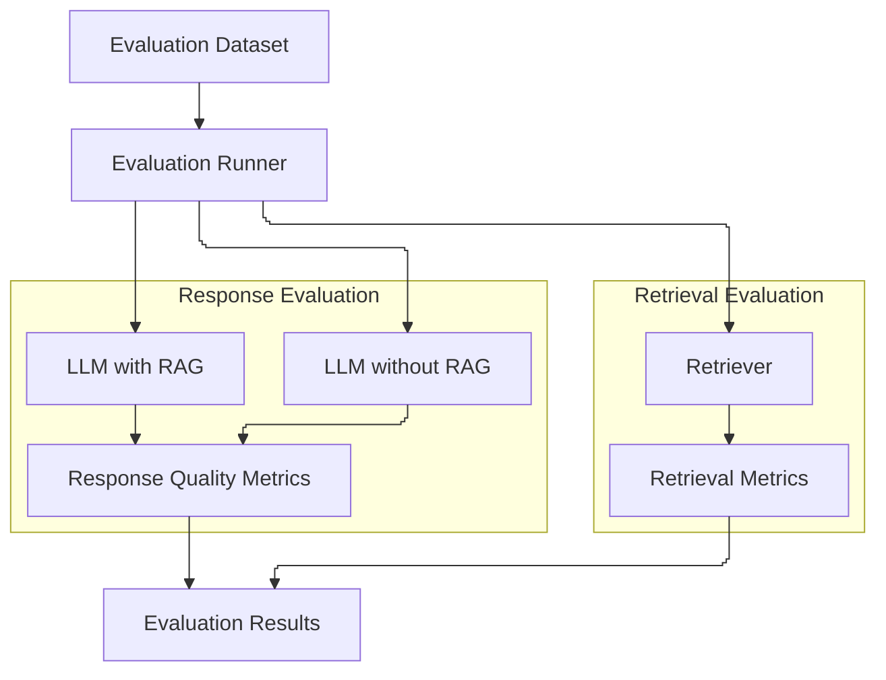

# Architecture Overview

## 1. Purpose

This document defines the software architecture of the Academic Chat Assistant, including its main components, responsibilities, dependencies, and interaction workflows.

The system integrates Large Language Models (LLMs) with Retrieval-Augmented Generation (RAG) to provide educational programming assistance supported by verifiable technical documentation.

The architecture is designed to:

- maintain separation of responsibilities;
- support programming assistance for C, C++, and Python;
- retrieve relevant technical documentation through RAG;
- preserve source references and version-specific information;
- support interchangeable LLM providers through a common interface;
- allow both external API inference and local model execution;
- evaluate retrieval quality and generated responses independently;
- remain maintainable and extensible without unnecessary infrastructure.

The Minimum Viable Product (MVP) will prioritize a functional end-to-end workflow over advanced infrastructure or architectural complexity.

## 2. Architectural Style

The system will follow a **Modular Monolith with Layered Architecture**.

The application will be organized into independent logical modules with clearly defined responsibilities while remaining a single backend application.

This approach allows the development team to maintain modularity without introducing the deployment and communication complexity of microservices.

### 2.1 Architectural Layers

The architecture will consist of the following logical layers:

| Layer | Responsibility |
|---|---|
| Presentation | User interaction and response visualization. |
| Application | Request validation, workflow orchestration, and conversation management. |
| RAG | Document ingestion, indexing, and retrieval. |
| LLM Integration | Provider-independent model interaction. |
| Model Inference | Execution of the selected language model. |
| Data Storage | Technical documentation, vector representations, and metadata. |
| Evaluation | Measurement of retrieval and response quality. |

The Evaluation Component will operate independently from the normal user interaction workflow.

### 2.2 General Architecture



The diagram represents logical dependencies rather than independently deployed services.

The MVP will use the Groq adapter for inference. Local inference will remain a supported architectural extension.

## 3. Main Components

### 3.1 Presentation Layer

The Presentation Layer provides the user interface through which students interact with the assistant.

Responsibilities:

- receive programming questions;
- accept source code and error messages;
- display generated explanations;
- display technical references;
- maintain the user-facing conversation;
- communicate with the backend API.

The frontend must not implement:

- LLM inference logic;
- document retrieval;
- embedding generation;
- knowledge base management.

### 3.2 Application Layer

The Application Layer coordinates the system's primary functionality.

Its responsibilities include:

- validating incoming requests;
- managing conversational context;
- coordinating RAG retrieval;
- constructing model context;
- invoking the configured LLM;
- processing generated responses;
- returning structured results;
- handling application errors.

#### Chat Service

The `ChatService` orchestrates the user interaction workflow.

Responsibilities:

- receive validated user requests;
- identify relevant programming language and version constraints;
- determine whether documentation retrieval is required;
- invoke the Retriever;
- coordinate context construction;
- invoke the LLM through its common interface;
- return the generated response and associated references.

The Chat Service must remain independent from specific LLM providers and vector storage implementations.

### 3.3 RAG Layer

The RAG Layer provides technical knowledge required to support accurate and verifiable responses.

It will be divided into two independent pipelines:

1. **Ingestion and Indexing Pipeline**
2. **Retrieval Pipeline**

Both pipelines will share access to the indexed knowledge base and compatible embedding representations.

#### 3.3.1 Ingestion and Indexing Pipeline

The indexing pipeline prepares technical documentation for retrieval.

Responsibilities:

- load selected technical documents;
- process documentation previously reviewed and accepted;
- clean and normalize extracted text when necessary;
- divide documents into coherent fragments;
- associate fragments with relevant metadata;
- generate embeddings;
- store document representations in the vector index.

The documentation collection will cover selected information related to:

- C language syntax and semantics;
- C++ language syntax and semantics;
- Python language syntax and semantics;
- standard library functionality;
- compiler documentation;
- interpreter documentation;
- language standards;
- version compatibility.

The initial version coverage is defined in `02_project_scope.md`.

The knowledge base will use controlled, reviewed documentation rather than unrestricted Internet retrieval.

The indexing pipeline will operate separately from normal user requests.

#### 3.3.2 Retrieval Pipeline

The retrieval pipeline searches the knowledge base for documentation relevant to a user question.

Responsibilities:

- receive a retrieval query;
- identify available language and version constraints;
- generate the query embedding;
- retrieve relevant document fragments;
- apply metadata filters when applicable;
- return retrieved content and source information;
- report retrieval failures or insufficient evidence.

The Retriever will return structured retrieval results rather than generating final natural-language answers.

A retrieval result should contain:

- document identifier;
- fragment identifier;
- retrieved content;
- source reference;
- relevant technical metadata;
- retrieval score, when available.

The initial implementation will use semantic retrieval with metadata filtering.

Advanced retrieval techniques are not required for the MVP.

#### 3.3.3 Embedding Component

The Embedding Component converts text into vector representations used for semantic retrieval.

It will be used during:

- document indexing;
- query processing.

The same embedding model and compatible preprocessing configuration must be used for document and query representations.

The embedding model will remain independent from the generative LLM.

Replacing the generative LLM will not require rebuilding the document index.

Replacing the embedding model may require regenerating embeddings and rebuilding the index.

The specific embedding model remains pending architectural evaluation.

### 3.4 Context Builder

The `ContextBuilder` constructs the information supplied to the LLM.

Responsibilities:

- incorporate the current user question;
- include relevant conversational history;
- preserve user-submitted code and error messages;
- incorporate retrieved technical documentation;
- include relevant language and version constraints;
- associate retrieved evidence with source identifiers;
- organize information into the model's input format;
- limit unnecessary context.

The Context Builder must distinguish between:

- application instructions;
- user input;
- conversation history;
- retrieved documentation.

Retrieved documentation must be treated as external information rather than executable instructions.

The Context Builder does not perform document indexing, retrieval, or model inference.

### 3.5 LLM Integration Layer

The LLM Integration Layer isolates the application from the specific language model or inference provider.

The architecture will use a common interface with interchangeable provider implementations.

#### LLMProvider Interface

The system will define an abstract `LLMProvider` interface.

A conceptual Python implementation is:

```python
from abc import ABC, abstractmethod

class LLMProvider(ABC):
    @abstractmethod
    def generate(self, messages: list[dict]) -> str:
        pass
```

The final interface may use structured request and response models when needed.

All providers must implement the same contract.

#### Provider Adapters

Each supported provider will implement an adapter responsible for:

- initializing the provider client;
- translating requests into provider-specific formats;
- invoking model inference;
- normalizing responses;
- handling provider-specific errors.

The initial implementation will include:

- `GroqProvider`

Future implementations may include:

- `LocalProvider`;
- additional API provider adapters.

The architecture will use interchangeable provider implementations following the Strategy Pattern.

Provider instantiation may be handled through a simple factory or dependency configuration.

#### Initial LLM Configuration

| Property | Configuration |
|---|---|
| Provider | Groq |
| Model | GPT-OSS-120B |
| Model identifier | `openai/gpt-oss-120b` |
| Inference | External API |
| Adapter | `GroqProvider` |
| Common interface | `LLMProvider` |
| Local inference | Future implementation |

Provider selection will be controlled through application configuration.

The backend and RAG components must not depend directly on the Groq SDK.

Changing the LLM provider should only require selecting or implementing the corresponding adapter, provided it satisfies the common interface.

### 3.6 Evaluation Component

The Evaluation Component will measure the quality of the assistant and its RAG implementation.

Responsibilities:

- load predefined evaluation tasks;
- execute retrieval tests;
- compare retrieved documents against reference evidence;
- evaluate generated responses;
- compare responses with and without RAG;
- record evaluation configurations;
- store evaluation results.

The component will reuse the same Retriever and LLM interfaces used by the application.

Evaluation will remain outside the normal student interaction workflow.

## 4. System Workflows

The architecture will support two primary workflows.

### 4.1 Documentation Ingestion and Indexing

The indexing workflow prepares the knowledge base.

Steps:

1. Select relevant technical documentation.
2. Review reliability, relevance, licensing, and version coverage.
3. Accept documents that satisfy the review criteria.
4. Load and preprocess accepted documents.
5. Divide documentation into meaningful fragments.
6. Associate fragments with source and version metadata.
7. Generate embeddings.
8. Store indexed information.



The indexing process will be executed when the knowledge base is created or updated.

It will not be repeated for each student query.

### 4.2 User Interaction and Retrieval

The user interaction workflow processes programming-related questions.

Steps:

1. The student submits a question.
2. The backend validates the request.
3. The Chat Service identifies available language and version context.
4. The Retriever searches the knowledge base when documentation is needed.
5. Relevant document fragments and metadata are returned.
6. The Context Builder prepares the model context.
7. The configured LLM generates a response.
8. The backend processes the response and verifies that presented references correspond to retrieved sources.
9. The frontend displays the explanation and applicable references.



When documentation is insufficient, the system must communicate uncertainty rather than present unsupported technical claims as verified facts.

Retrieved documents must not be allowed to override application instructions.

## 5. Knowledge Base and Data Storage

### 5.1 Technical Documentation

The knowledge base will contain reviewed technical documentation covering selected programming language features, standard libraries, compiler behavior, and version compatibility.

Documentation must retain sufficient information to identify its original source.

The collection does not need to provide exhaustive coverage of all supported languages and versions.

### 5.2 Vector Storage

The RAG implementation will use a local searchable vector index.

It must support:

- document embeddings;
- document fragments;
- similarity-based retrieval;
- document identifiers;
- metadata-based filtering;
- source traceability.

A distributed vector database is not required.

The specific storage technology remains pending selection.

### 5.3 Document Metadata

Each indexed fragment must preserve sufficient metadata to support retrieval, source traceability, and version-aware reasoning.

| Field | Purpose |
|---|---|
| `document_id` | Identifies the source document. |
| `chunk_id` | Identifies the indexed fragment. |
| `source` | Identifies the publisher or documentation source. |
| `source_url` | References the original documentation. |
| `language` | Identifies C, C++, or Python. |
| `language_standard` | Identifies the applicable language standard. |
| `compiler` | Identifies the compiler implementation. |
| `compiler_version` | Identifies the applicable compiler version. |
| `interpreter_version` | Identifies the applicable interpreter version. |
| `review_status` | Records the documentation review status. |

Version-related metadata must represent the documented applicability of the source rather than an unsupported assumption.

Metadata fields that do not apply to a document may remain unspecified.

The final metadata schema will be established during knowledge base implementation.

### 5.4 Version-Aware Retrieval

The system must distinguish between:

- programming language standards;
- compiler versions;
- compiler feature support;
- interpreter versions.

For example, a document describing a C++23 feature does not establish that every version of GCC supporting the `-std=c++23` option implements that feature.

The Retriever will use relevant metadata to restrict or prioritize documentation.

When version information is missing, ambiguous, or unsupported by the available sources, the system must avoid making unverified compatibility claims.

The MVP will not require actual compilation or execution to verify compatibility.

### 5.5 Conversation and Evaluation Data

Conversation context will initially be maintained only as required for active interactions.

Persistent conversation storage is not mandatory.

Evaluation results may be stored using structured local files.

A separate relational database is not required for the MVP.

## 6. RAG Evaluation Architecture

The evaluation workflow will assess retrieval performance and generated answer quality separately.

It will use predefined programming questions and reference information.

### 6.1 Retrieval Evaluation

Retrieval will be evaluated against a controlled dataset containing questions and relevant reference documents.

Selected metrics may include:

| Metric | Purpose |
|---|---|
| Recall@k | Measures the proportion of relevant reference documents retrieved within the top-k results. |
| Precision@k | Measures the proportion of retrieved top-k documents that are relevant. |
| Hit Rate@k | Measures whether at least one relevant document appears within the top-k results. |

The evaluation dataset must identify relevant reference documents or fragments to calculate these metrics.

### 6.2 Response Evaluation

Generated responses will be evaluated using criteria such as:

- technical correctness;
- explanation correctness;
- clarity;
- relevance;
- educational usefulness;
- groundedness;
- source traceability;
- version compatibility when applicable.

The evaluation must distinguish between retrieval failures and errors introduced during response generation.

### 6.3 Comparative Evaluation

The system will support comparison between:

1. LLM responses generated without RAG.
2. LLM responses generated with RAG.

Both configurations should use equivalent evaluation questions, model settings, and scoring criteria.

The comparison will help determine whether RAG improves technical correctness, evidence grounding, and source traceability.



The evaluation process will record relevant configurations, retrieved references, generated answers, and evaluation results.

Detailed metric definitions, scoring procedures, and acceptance thresholds will be specified in the evaluation documentation.

A separate evaluation microservice is not required.

## 7. Security Considerations

The architecture must treat user input and retrieved documentation as untrusted data.

The system shall:

- validate incoming requests;
- store API credentials outside source code;
- avoid executing user-submitted code;
- avoid executing commands contained in retrieved documentation;
- separate retrieved content from application-level instructions;
- prevent retrieved content from being treated as authoritative instructions;
- avoid exposing confidential configuration information;
- safely render generated responses and retrieved content in the frontend;
- avoid fabricating technical references.

RAG reduces dependence on the model's internal knowledge but does not eliminate hallucinations or prompt-injection risks.

Additional security mechanisms may be introduced when justified by evaluation or implementation requirements.

## 8. Architectural Principles

The implementation will follow these principles:

- **Separation of Concerns:** components must have clearly defined responsibilities.
- **Low Coupling:** modules should communicate through well-defined interfaces.
- **Modularity:** application logic, RAG, and LLM inference must remain logically separated.
- **Provider Independence:** the backend must depend on the `LLMProvider` abstraction rather than a specific provider.
- **Retrieval Independence:** document indexing and retrieval must remain independent from the generative LLM.
- **Source Traceability:** retrieved evidence must retain references to its original documentation.
- **Version Awareness:** compatibility information must account for applicable language standards and implementations.
- **Security:** external documentation must not be treated as executable application instructions.
- **Reproducibility:** relevant model, retrieval, and evaluation configurations must be identifiable.
- **Incremental Development:** components should be implemented and validated progressively.
- **Scope Control:** additional complexity must be justified by an explicit requirement.
- **Maintainability:** the architecture must remain understandable and manageable for the development team.

## 9. Open Architectural Decisions

The following decisions remain pending formal evaluation or approval.

| Decision | Proposed Direction | Status |
|---|---|---|
| General architecture | Modular layered monolith | Proposed |
| RAG integration | Required MVP component | Proposed |
| Initial LLM provider | Groq | Proposed |
| Initial LLM | GPT-OSS-120B | Proposed |
| LLM abstraction | Common `LLMProvider` interface | Proposed |
| Local inference | Future adapter implementation | Proposed |
| Backend framework | FastAPI | Proposed |
| Frontend framework | Web-based frontend | Proposed |
| Embedding model | Lightweight model supporting relevant query and documentation languages | Proposed |
| Vector database | Local vector storage | Proposed |
| Document processing | Controlled ingestion of reviewed documents | Proposed |
| Chunking strategy | Structure-aware document fragmentation | Proposed |
| Retrieval strategy | Semantic retrieval with metadata filtering | Proposed |
| Metadata schema | Source, language, standard, and version metadata | Proposed |
| Conversation management | Active-session context | Proposed |
| Evaluation storage | Structured local files | Proposed |
| Containerization | Minimal deployment strategy | Proposed |

These directions establish the intended architecture but do not imply that every technology-specific decision has been approved.

Decisions that materially affect the architecture will be recorded through Architecture Decision Records (ADRs), following `02_architecture_decisions.md`.

The implementation should prioritize a functional end-to-end workflow integrating the frontend, backend, RAG, and GPT-OSS-120B through Groq before introducing additional providers or advanced retrieval capabilities.